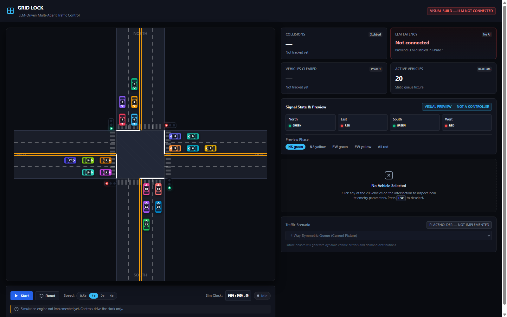

# 🚦 GRID LOCK — Autonomous Intersection
### LLM-Driven Multi-Agent Traffic Control

[](https://fastapi.tiangolo.com)
[](https://react.dev)
[](https://vitejs.dev)
[](https://www.python.org)
[](https://ai.google.dev)
[](https://vitest.dev)
[](https://pytest.org)
[](LICENSE)

**GRID LOCK** is an intelligent transportation research platform and simulation benchmark designed to evaluate multi-agent vehicle coordination at a 4-way intersection using **a single batch LLM API call per decision tick**.

Rather than relying on omniscient bird's-eye coordinates, each autonomous vehicle operates strictly on **local, ego-centric sensor telemetry** (front/rear distance, relative velocity, blind-spot side clearance, and signal state). A centralized or roadside LLM controller coordinates all active vehicles simultaneously under real-world physical constraints, testing LLM spatial reasoning, safety critical decision-making, and deadlock avoidance.



---

## 🌟 Key Features & Innovations

- **Deterministic Pure-JS Physics Engine**:
  Fixed timestep ($\Delta t = 0.02\text{ s}$ / $50\text{ Hz}$), zero DOM/canvas coupling, analytical piecewise kinematics with jerk limiting ($8.0\text{ m/s}^3$), and mathematically proven anti-tunneling bounds ($\Delta s_{\max} = 0.27\text{ m} < 0.95\text{ m}$).
- **Zero-Tolerance Honesty & No Phantom Physics**:
  Zero emergency braking overrides, zero phantom bumper repulsion, and zero artificial speed clamping. If an external controller commands unsafe acceleration into a conflict, vehicles collide physically.
- **Strict Local Telemetry (Ego-Centric Only)**:
  Zero global coordinates $(x, y)$. Vehicles perceive the world exclusively through local body-frame corridors (bumper-to-bumper gaps, relative velocity, adjacent lane blind-spot clearances, and stop-line distance).
- **Single Batch LLM Call Per Decision Tick**:
  Exactly **ONE** provider request per tick for all active vehicles—never per-vehicle polling. Transport-level `retries=0`, single-flight lock (`asyncio.Lock`), and immutable call ledger verification.
- **Dual Simulation Clock Policies**:
  - **Lockstep Mode**: Pauses the simulation clock while awaiting LLM inference for reproducible benchmark evaluations.
  - **Realtime Mode**: Continuous 50 Hz physics execution with decision age tracking and fallback safety buffers.
- **2D Oriented Bounding Box (OBB) SAT Collision Detection**:
  Continuous contact transition tracking using Separating Axis Theorem (SAT), counting distinct collision incidents without duplicate spam.
- **Comprehensive Developer & Research HUD**:
  Includes interactive HTML5 Canvas, live Telemetry Inspector with JSON Schema validation, Prompt Inspector, Decision Inspector, and Vehicle Inspector.

---

## 🏛️ System Architecture

```
                          ┌──────────────────────────────────────────────┐
                          │         Frontend (React + Vite + HTML5)      │
                          │                                              │
                          │  ┌──────────────┐      ┌──────────────────┐  │
                          │  │  50 Hz Engine│◄────►│Decision Scheduler│  │
                          │  │ (Physics+SAT)│      │(Lockstep/Realtime│  │
                          │  └──────┬───────┘      └────────┬─────────┘  │
                          └─────────┼───────────────────────┼────────────┘
                                    │ Local Telemetry       │ Batch Actions
                                    ▼ Batch                 ▼
                          ┌──────────────────────────────────────────────┐
                          │       JSON Schema Validation Layer           │
                          │  telemetry.schema.json / decisions.schema.json│
                          │        (Ajv Draft-07 & Pydantic v2)          │
                          └─────────────────┬────────────────────────────┘
                                            │ HTTP POST /api/decide
                                            ▼
                          ┌──────────────────────────────────────────────┐
                          │         Backend Server (FastAPI)             │
                          │                                              │
                          │  ┌────────────────────────────────────────┐  │
                          │  │ Single-Flight Concurrency Lock         │  │
                          │  ├────────────────────────────────────────┤  │
                          │  │ Immutable Call Ledger (Max 1 req/tick) │  │
                          │  ├────────────────────────────────────────┤  │
                          │  │ Prompt Compiler (Zero Coords Leak)     │  │
                          │  └──────────────────┬─────────────────────┘  │
                          └─────────────────────┼────────────────────────┘
                                                │ Streaming / REST (retries=0)
                                                ▼
                                    ┌───────────────────────┐
                                    │   Google Gemini API   │
                                    │ (gemini-3.1-flash-lite)│
                                    └───────────────────────┘
```

---

## 🔒 Non-Negotiable Invariants

1. **No Global Coordinates in Telemetry**:
   Any presence of `x`, `y`, or absolute heading in telemetry payloads violates the schema and fails tests. Sensors strictly report body-frame relative metrics.
2. **Exactly One Provider Request Per Tick**:
   No SDK auto-retries, no fallback models, no secondary repair calls. Every decision tick ID is strictly monotonic and non-reusable.
3. **True Physical Consequences**:
   HUD collision metrics reflect genuine OBB polygon intersections. The simulation never fabricates or suppresses collision events.
4. **Cross-Language Contract Parity**:
   Every fixture valid under frontend Ajv (Draft-07) is guaranteed valid under backend Pydantic v2, and vice-versa, with `additionalProperties: false` strictly enforced.

---

## 📁 Repository Structure

```
autonomous-intersection/
├── .env.example                     # Environment template (Gemini API key & provider)
├── .gitignore                       # Strict ignore rules (secrets, venv, node_modules)
├── package.json                     # Root orchestration scripts
├── README.md                        # Project documentation & benchmark guide
│
├── contracts/                       # Shared Data Contracts (Single Source of Truth)
│   ├── telemetry.schema.json        # Strict local sensor JSON schema
│   ├── decisions.schema.json        # Commanded action batch schema
│   └── fixtures/                    # Valid & invalid test matrices for CI parity
│       ├── valid/                   # Minimal, full-active, and sample batches
│       ├── invalid/                 # Canary checks (denylist, extra fields, bad enums)
│       └── decisions/               # Commanded action schema edge-case fixtures
│
├── backend/                         # Decision Server (FastAPI + Pydantic v2)
│   ├── main.py                      # FastAPI application entrypoint & REST routes
│   ├── config.py                    # Provider configuration & timeout settings
│   ├── telemetry_schema.py          # Pydantic v2 telemetry contract
│   ├── decision_schema.py           # Pydantic v2 decision contract
│   ├── prompts/
│   │   ├── system_v1.txt            # System prompt with strict JSON output rules
│   │   └── user_template.txt        # Local telemetry compilation template
│   ├── services/
│   │   ├── decision_service.py      # Orchestrator with single-flight concurrency lock
│   │   ├── call_ledger.py           # Thread-safe audit ledger (zero retry invariant)
│   │   ├── prompt_builder.py        # Telemetry-to-prompt serializer
│   │   └── llm/provider.py          # Google Gemini / OpenAI transport client (retries=0)
│   └── tests/                       # Pytest test suite (39 tests)
│       ├── test_api_endpoints.py     # Endpoint contracts & validation errors
│       ├── test_decision_schema.py  # Ajv parity & edge case verification
│       ├── test_prompt_leak.py      # Spatial leak & coordinate canary tests
│       └── test_provider_transport.py # Zero-retry & ledger enforcement tests
│
├── frontend/                        # Simulation Dashboard (React 18 + Vite + Vitest)
│   ├── index.html                   # HTML entrypoint
│   ├── vite.config.js               # Build & test configuration
│   └── src/
│       ├── App.jsx                  # Root dashboard layout & simulation loop
│       ├── components/              # Interactive UI modules
│       │   ├── SimulationCanvas.jsx # HiDPI canvas with OBB hit-testing
│       │   ├── ControlBar.jsx       # Play/pause/step, clock policy, controller select
│       │   ├── HudPanel.jsx         # Live telemetry & physical performance metrics
│       │   ├── TelemetryInspector.jsx# Local sensor readout & schema validator badge
│       │   ├── PromptInspector.jsx  # Raw LLM prompt viewer
│       │   ├── DecisionInspector.jsx# LLM response parser & latency ledger
│       │   ├── VehicleInspector.jsx # Vehicle telemetry & manual action commander
│       │   └── SignalLegend.jsx     # Traffic phase timing & state indicator
│       ├── contracts/               # Ajv schema validators & parity wrappers
│       ├── controllers/             # LLM Controller + Baseline Controllers
│       ├── hooks/                   # useCanvasLoop & useElementSize
│       ├── rendering/               # Pure HTML5 canvas rendering pipeline
│       ├── services/                # DecisionClient & DecisionScheduler
│       ├── simulation/              # 50 Hz deterministic physics & SAT collision engine
│       ├── telemetry/               # Local body-frame sensor builders
│       └── tests/                   # Vitest unit & integration test suite (89 tests)
│
└── docs/                            # Research & Engineering Specifications
    ├── physics.md                   # Kinematic equations, SAT OBB, anti-tunneling
    ├── contracts.md                 # Telemetry & decision JSON contract specs
    ├── telemetry.md                 # Local sensor geometry & coordinate rejection
    └── llm-integration.md           # LLM batch protocol, clock policies & ledger
```

---

## ⚡ Quick Start Guide

### 1. Prerequisites
- **Node.js**: v18.0.0 or higher
- **Python**: v3.10 or higher
- **Google Gemini API Key** (or OpenAI API key): [Get an AI Studio Key](https://aistudio.google.com/app/apikey)

---

### 2. Environment Setup

Clone the repository and create your environment configuration:

```bash
# Clone the repo
git clone https://github.com/kratigupta04012008-ui/gridlock.git
cd gridlock

# Copy environment example
cp .env.example .env
```

Edit `.env` and add your Google Gemini API key:
```env
LLM_PROVIDER=gemini
GEMINI_API_KEY=your_actual_gemini_api_key_here
LLM_MODEL=gemini-3.1-flash-lite
LLM_TIMEOUT_S=10.0
LLM_TEMPERATURE=0.0
```

---

### 3. Start the Backend Decision Server

In a new terminal window:

```bash
# Install Python dependencies
pip install fastapi uvicorn pydantic google-genai httpx pytest pytest-asyncio python-dotenv

# Start FastAPI server on port 8000
python -m uvicorn backend.main:app --port 8000 --reload
```
*The decision server will run at `http://localhost:8000` (API docs at `http://localhost:8000/docs`).*

---

### 4. Start the Frontend Simulation Dashboard

In a second terminal window:

```bash
# Install frontend dependencies
cd frontend
npm install

# Start Vite dev server
npm run dev
```
*Open [http://localhost:5173](http://localhost:5173) in your browser.*

---

## 🧪 Running the Test Suite

The project maintains rigorous test coverage with **128 total tests** across the entire stack:

### Frontend Unit & Contract Tests (Vitest)
```bash
# From repository root
npm test

# Or directly in frontend/
cd frontend && npm test
```
*Runs all 89 Vitest tests across 14 suites (physics determinism, OBB SAT collision transitions, Ajv schema verification, clock policies, and sensor locality).*

### Backend & Invariant Tests (Pytest)
```bash
# From repository root
npm run test:py

# Or via pytest directly
pytest backend -v
```
*Runs all 39 Pytest tests (Pydantic schema parity, zero-retry call ledger enforcement, single-flight locking, and prompt coordinate leak verification).*

---

## 📊 Evaluation & Baseline Controllers

The dashboard allows side-by-side comparison between the LLM Batch Controller and traditional baseline heuristic controllers:

| Controller | Description | Typical Throughput | Safety / Collisions |
| :--- | :--- | :--- | :--- |
| **Signal Follower** | Standard rule-based controller that obeys cyclic traffic lights. | Moderate | Zero collisions (clears when green) |
| **Coast** | Idle engine; applies zero acceleration or braking. | Very low | Prone to blockages |
| **Constant Accel** | Naive vehicle acceleration without situational awareness. | High risk | Guaranteed collisions |
| **LLM Batch Controller** | Google Gemini (`gemini-3.1-flash-lite`) coordinating all 20 vehicles via local sensor telemetry. | Dynamic | Negotiates conflict points; audited via live HUD |

---

## 📜 Physics & Sensor Specifications

| Parameter | Value | Rationale / Mathematical Bounds |
| :--- | :--- | :--- |
| **Simulation Step ($\Delta t$)** | $0.02\text{ s}$ ($50\text{ Hz}$) | Decoupled from 60 FPS animation via time accumulator |
| **World Scale** | $10\text{ px/m}$ | $800 \times 800\text{ px} = 80 \times 80\text{ m}$ real-world intersection |
| **Max Speed ($v_{\max}$)** | $13.5\text{ m/s}$ ($\approx 48.6\text{ km/h}$) | Standard urban intersection speed limit |
| **Acceleration Limits** | $[-6.0\text{ m/s}^2, +3.0\text{ m/s}^2]$ | Real-world passenger vehicle deceleration & throttle bounds |
| **Jerk Limit ($J_{\max}$)** | $8.0\text{ m/s}^3$ | Passenger ride comfort and realistic actuator response |
| **Anti-Tunneling Proof** | $\Delta s_{\max} = 0.27\text{ m}$ | Half-car width is $0.95\text{ m} > 0.27\text{ m}$, mathematically preventing tunneling |
| **Collision Geometry** | Oriented Bounding Box (OBB) | 2D Separating Axis Theorem with contact state transitions |

---

## 📄 License

This project is licensed under the [MIT License](LICENSE).
